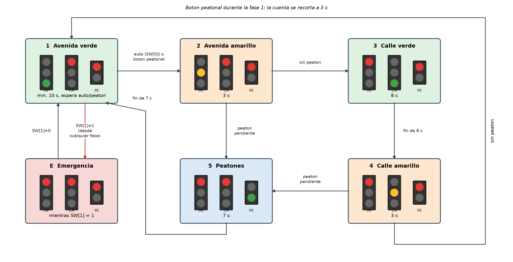
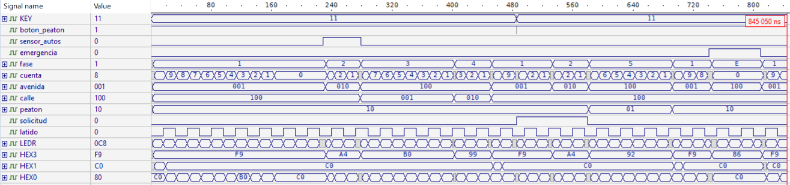

# Semáforo inteligente con un procesador RISC-V en la DE10-Lite

Proyecto final de Arquitecturas Computacionales (UDLAP, Departamento de Computación, Electrónica y Mecatrónica).

Hicimos un procesador RISC-V de 32 bits multiciclo en Verilog y le cargamos en la ROM un programa que controla un semáforo. Todo corre en la tarjeta Terasic DE10-Lite. Para armar el procesador reutilizamos los módulos que hicimos en clase (ALU, sumador, mux, registro, ROM, RAM y la unidad de control) y le agregamos lo que faltaba.


## Qué hace el semáforo

Es un cruce con una avenida, una calle y un paso peatonal:

- La avenida siempre tiene al menos 10 s de verde.
- Si no hay autos en la calle (SW0 apagado), la avenida se queda en verde. Si llega un auto, se le da 8 s de verde a la calle.
- Si un peatón presiona el botón, se guarda la solicitud, el verde de la avenida se corta a 3 s y los peatones tienen 7 s para cruzar.
- Con el switch de emergencia todo se pone en rojo hasta que se apague.
- En los displays sale la cuenta regresiva y el número de fase.
- En la RAM se van contando los peatones, las emergencias y las veces que pasó la calle.



| Fase | Avenida | Calle | Peatones | Duración |
|:-:|:-:|:-:|:-:|:-:|
| 1 | verde | rojo | rojo | 10 s o más (hasta que haya auto o peatón) |
| 2 | amarillo | rojo | rojo | 3 s |
| 3 | rojo | verde | rojo | 8 s |
| 4 | rojo | amarillo | rojo | 3 s |
| 5 | rojo | rojo | verde | 7 s |
| E | rojo | rojo | rojo | mientras SW1 esté arriba |

## Cómo se usa en la tarjeta

Entradas:

- `KEY0`: reset
- `KEY1`: botón del peatón
- `SW0`: sensor de autos
- `SW1`: emergencia

Salidas:

- `LEDR9-7`: avenida (rojo, amarillo, verde)
- `LEDR6-4`: calle (rojo, amarillo, verde)
- `LEDR3-2`: peatones (rojo, verde)
- `LEDR1`: hay un peatón esperando
- `LEDR0`: parpadea cada segundo
- `HEX1 HEX0`: segundos que faltan
- `HEX3`: fase (1 a 5, o E en emergencia)
- `GPIO0-7`: los LEDs de colores de la protoboard

### Protoboard

Como los LEDs de la tarjeta son todos rojos, el profe nos sugirió sacar las luces por el conector GPIO (JP1) a LEDs de colores en una protoboard. Cada LED va así: pin GPIO → resistencia de 220 Ω → pata larga del LED, y la pata corta a GND (pin 12). Ojo: el pin 11 es de 5 V, no hay que conectar nada ahí.

| Pin JP1 | Señal | Pin FPGA | LED |
|:-:|---|---|---|
| 1 | GPIO[0] | PIN_V10 | rojo avenida |
| 2 | GPIO[1] | PIN_W10 | amarillo avenida |
| 3 | GPIO[2] | PIN_V9 | verde avenida |
| 4 | GPIO[3] | PIN_W9 | rojo calle |
| 5 | GPIO[4] | PIN_V8 | amarillo calle |
| 6 | GPIO[5] | PIN_W8 | verde calle |
| 7 | GPIO[6] | PIN_V7 | rojo peatón |
| 8 | GPIO[7] | PIN_W7 | verde peatón |
| 12 | GND | - | patas cortas de todos los LEDs |


Material:

- 3 LEDs rojos, 2 amarillos y 3 verdes (5 mm)
- 8 resistencias de 220 Ω (rojo-rojo-café)
- 1 protoboard
- 9 jumpers hembra-macho (8 señales + GND) y unos cuantos macho-macho para el riel de tierra

Es buena idea llevar un par de LEDs y resistencias de más por si alguno se quema o se rompe una pata.

Usamos 220 Ω porque los pines de la FPGA sacan 3.3 V. Con un LED rojo (más o menos 2 V) quedan (3.3 - 2.0) / 220 ≈ 6 mA, que alcanza para que se vea bien sin forzar el pin. Con 330 Ω también prende pero más bajito; menos de 150 Ω ya no conviene. Los verdes tienen que ser normales, los ultrabrillantes piden casi 3 V y con 3.3 V apenas prenden.

Armado:

1. Con la tarjeta desconectada, ubicar el pin 1 de JP1 (viene marcado). Los pines van de dos en dos: 1-2, 3-4, etc. El 11 es 5 V y el 12 es GND.
2. Del pin 12 sacar un cable al riel negativo de la protoboard.
3. Para cada LED: jumper del pin de JP1 a una fila, resistencia de esa fila a otra, la pata larga del LED en la fila de la resistencia y la pata corta al riel negativo.
4. Acomodarlos como semáforo (rojo arriba, amarillo, verde abajo) en tres grupos.
5. Revisar que nada esté en el pin 11 y que ningún cable toque dos pines.
6. Conectar el USB, programar desde Quartus y darle reset con KEY0.

Al arrancar deben prender el verde de la avenida, el rojo de la calle y el rojo del peatón. Si alguno no prende, lo más seguro es que esté volteado.

## El procesador

- Subconjunto de RV32I más `mul`: 25 instrucciones de los formatos R, I, S, B, U y J.
- Multiciclo, con una máquina de estados que sale de la `uc_simple` de clase.
- 32 registros de 32 bits, ROM de 128 instrucciones y RAM de 32 palabras.
- Corre a 12.5 MHz (los 50 MHz de la tarjeta entre 4).

| Formato | Instrucciones |
|---|---|
| R | add, sub, and, or, xor, slt, sll, srl, sra, mul |
| I | addi, andi, ori, xori, slti, slli, srli, srai, lw, jalr |
| S | sw |
| B | beq, bne, blt |
| U | lui |
| J | jal |


Ciclos por instrucción:

| Instrucción | Estados | Ciclos |
|---|---|:-:|
| R, I, lui | FETCH, DECODE, EXEC_R, WRITEBACK | 4 |
| lw | FETCH, DECODE, MEM_ADDR, MEM_READ, WRITEBACK | 5 |
| sw | FETCH, DECODE, MEM_ADDR, MEM_WRITE | 4 |
| beq, bne, blt | FETCH, DECODE, EXEC_B | 3 |
| jal, jalr | FETCH, DECODE, EXEC_J | 3 |


### Módulos

De clase, sin cambios:

- `alu_riscv`: la ALU de 32 bits
- `adder_nbits`: para PC+4 y PC+inmediato
- `mux_4a1`: escoge qué se escribe en el registro destino
- `pipo_register`: el PC

De clase, con cambios:

- `rom_file`: memoria de instrucciones, se carga con `$readmemh`
- `ram`: memoria de datos (le corregimos la polaridad de `we`)
- `unidad_control`: la FSM de `uc_simple` con los estados de saltos y el decodificador de la ALU

Nuevos:

- `banco_registros`: 32 registros, x0 siempre en 0
- `generador_inmediatos`: saca el inmediato según el formato
- `procesador_riscv`: la ruta de datos completa
- `perifericos_io`: los registros de entrada/salida mapeados en memoria
- `divisor_tick` y `divisor_reloj`: el tick de 1 s y el reloj del procesador
- `bin_a_bcd` y `decodificador_7seg`: para los displays
- `semaforo_soc`: procesador + RAM + periféricos
- `semaforo_de10lite`: el top-level con los pines de la tarjeta

## Mapa de memoria

| Dirección | Qué es | Acceso | Para qué |
|---|---|:-:|---|
| 0x000 - 0x07F | RAM | L/E | datos y estadísticas |
| 0x400 | LEDS | E | las luces |
| 0x404 | CUENTA | E | los segundos de HEX1 HEX0 |
| 0x408 | FASE | E | la fase de HEX3 |
| 0x40C | SWITCHES | L | los switches ya sincronizados |
| 0x410 | PEATON | L/E | solicitud del peatón (al escribir se borra) |
| 0x414 | TICK | L/E | ya pasó un segundo (al escribir se borra) |

## Carpetas

```
Arquis_ProyectoFinal.aws                 workspace de Active-HDL
Arquis_ProyectoFinal/Arquis_ProyectoFinal/
    Arquis_ProyectoFinal.adf             diseño de Active-HDL
    resultados_tb_*.txt                  lo que imprime cada testbench
    src/
        *.v                              módulos
        tb_*.v                           testbenches
        programa_semaforo.asm/.hex/.lst      programa del semáforo
        prueba_instrucciones.asm/.hex/.lst   programa para probar el procesador
quartus/
    semaforo_de10lite.qpf / .qsf         proyecto y pines
    semaforo_de10lite.sdc                relojes
    pines_de10lite.csv / .tcl            pines para importar en otro proyecto
    programa_semaforo.hex                el programa que se mete en la ROM
Reporte/                                 reporte en LaTeX
```

El `.asm` es el programa en ensamblador, el `.hex` es el código máquina que lee la ROM y el `.lst` tiene los dos juntos con la dirección de cada instrucción.

## Simulación (Active-HDL)

1. Abrir `Arquis_ProyectoFinal.aws`.
2. Design → Compile All.
3. Poner el testbench como top-level y Simulation → Initialize Simulation.
4. Agregar las señales al waveform y correr.

Testbenches:

- `tb_banco_registros`: escribir/leer, x0 = 0 y reset
- `tb_perifericos_io`: registros de E/S, sincronizadores, botón y tick
- `tb_procesador_riscv`: corre `prueba_instrucciones.hex` y revisa 25 registros y la RAM
- `tb_semaforo_de10lite`: todo el sistema (arranque, autos, peatón, emergencia, displays y GPIO)

En la simulación del semáforo usamos `TICK_DIV = 200` para que un "segundo" dure 16 µs y no tarde horas. En la tarjeta es `TICK_DIV = 12 500 000`.

## Quartus

1. Abrir `quartus/semaforo_de10lite.qpf` en Quartus Prime Lite (FPGA `10M50DAF484C7G`).
2. Processing → Start Compilation.
3. Tools → Programmer, escoger `output_files/semaforo_de10lite.sof` y darle Start.

Los pines ya vienen en el `.qsf`, incluyendo los 8 GPIO de la protoboard. Se pueden ver en Assignments → Pin Planner, y para pasarlos a otro proyecto está `quartus/pines_de10lite.csv` (Assignments → Import Assignments).

Hay que bajar el repositorio completo y no solo la carpeta `quartus/`, porque el proyecto agarra los `.v` de `Arquis_ProyectoFinal/Arquis_ProyectoFinal/src/`.

Si es más fácil, está [`Quartus_Semaforo_DE10Lite.zip`](Quartus_Semaforo_DE10Lite.zip) con solo lo necesario para Quartus (proyecto, pines, `.sdc`, `.hex` y los 17 `.v`). Se descomprime en una ruta corta, por ejemplo `C:\semaforo\`, y se abre `quartus\semaforo_de10lite.qpf`.

## Resultados

Los cuatro testbenches pasaron:

| Testbench | Pruebas |
|---|:-:|
| Banco de registros | 9 / 9 |
| Periféricos | 8 / 8 |
| Procesador | 27 / 27 (184 ciclos, CPI de 3.76) |
| Semáforo | 7 / 7 escenarios |

Simulación completa del semáforo:



Cuando se presiona el botón del peatón la cuenta baja a 3 s y luego sigue la fase 5:


Emergencia, todo en rojo:


El procesador ejecutando instrucciones tipo R (estados 0, 1, 2, 6):


El análisis completo viene en el reporte (`Reporte/main.tex`).

## Equipo

- Juan Diego Acosta Ojeda (185015)
- Mario Cardeña García (180220)

Profesor: Omar Guillén Fernández. Diciembre 2026.
