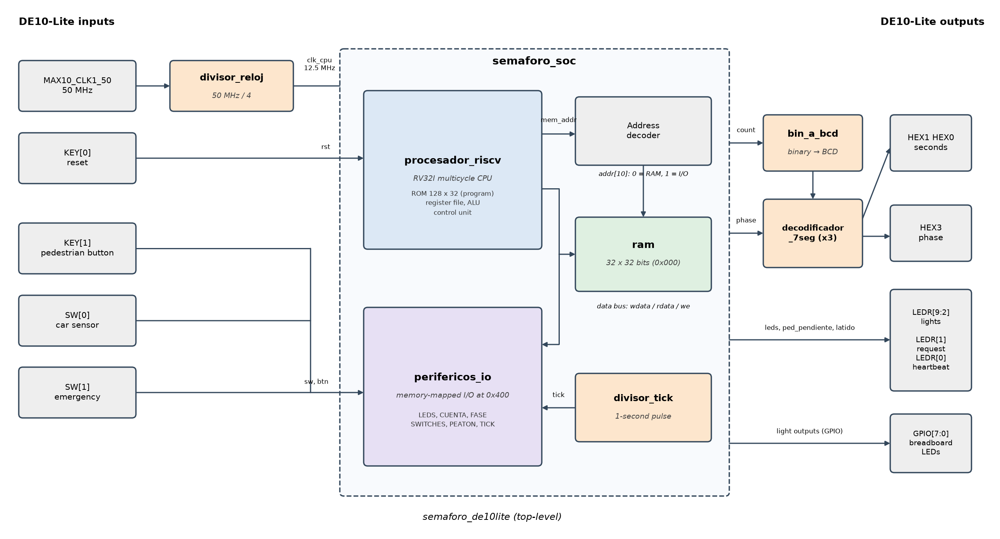
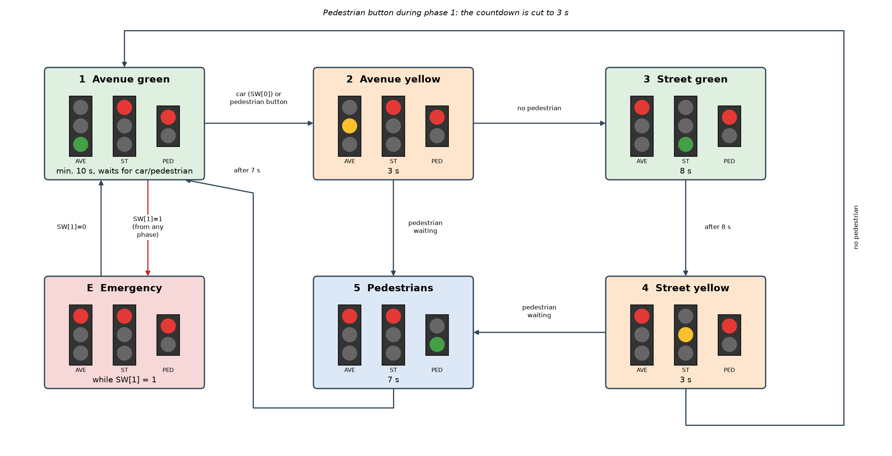
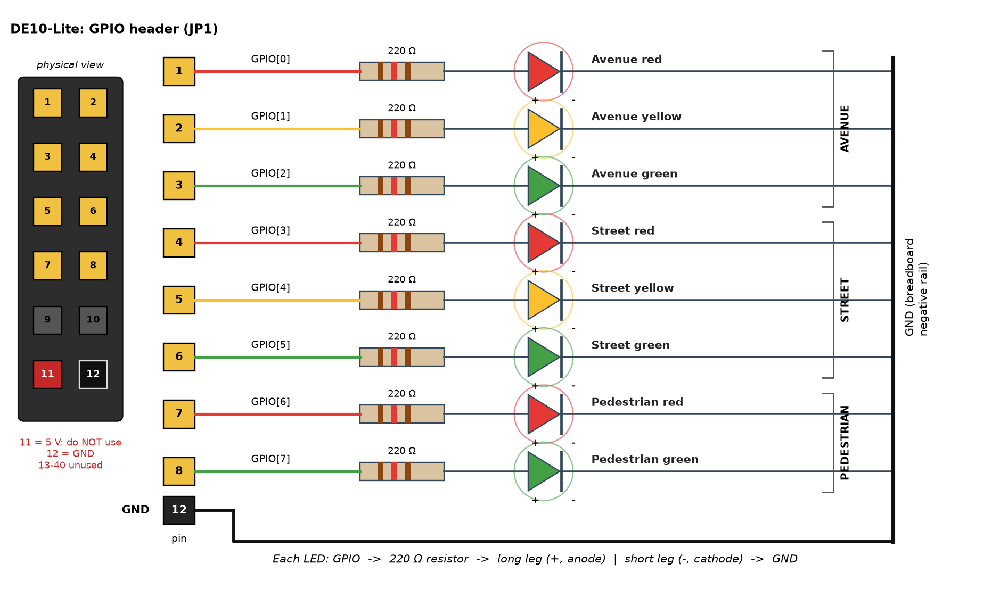
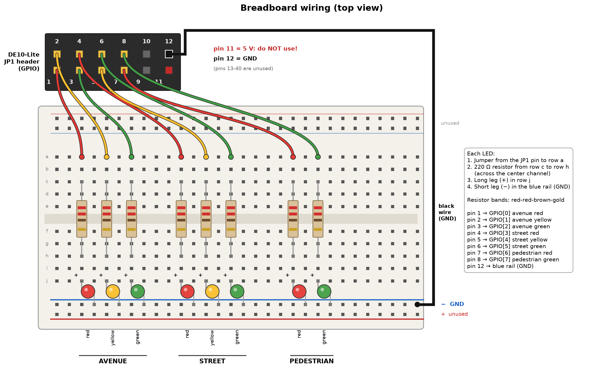
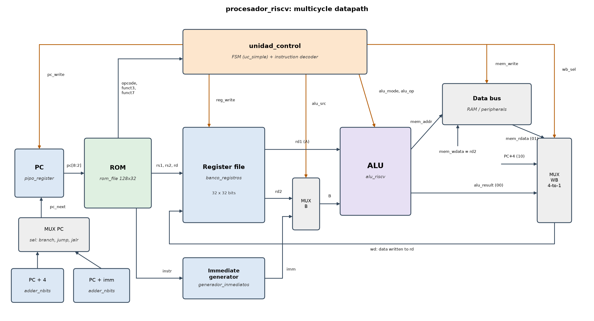
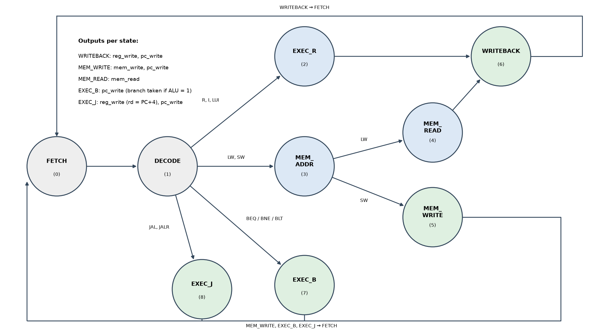
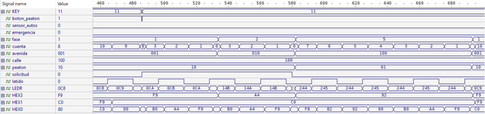
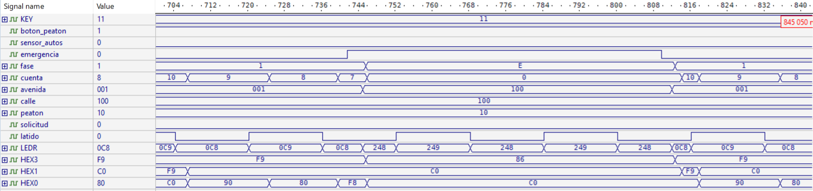

# Smart Traffic Light on a RISC-V Processor (DE10-Lite FPGA)

A 32-bit multicycle RISC-V processor written in Verilog. The processor runs a smart traffic light controller from its instruction ROM on a Terasic DE10-Lite board (Intel MAX 10).

This was the final project for **Computer Architecture** (Arquitecturas Computacionales) at Universidad de las Américas Puebla, Department of Computing, Electronics and Mechatronics. The processor is built on the modules developed during the course: ALU, adder, multiplexer, register, ROM, RAM and control unit. We extended them into a complete system-on-chip with memory-mapped I/O.



## Table of Contents

- [Features](#features)
- [Board Interface](#board-interface)
- [Breadboard Traffic Lights](#breadboard-traffic-lights)
- [Processor Architecture](#processor-architecture)
- [Memory Map](#memory-map)
- [Repository Structure](#repository-structure)
- [Simulation (Active-HDL)](#simulation-active-hdl)
- [Synthesis and Programming (Quartus)](#synthesis-and-programming-quartus)
- [Results](#results)
- [Authors](#authors)

## Features

The controller manages an intersection with a main avenue, a side street and a pedestrian crossing.

| Feature | Behavior |
|---|---|
| Minimum green | The avenue always gets at least 10 s of green |
| Car sensor | With no cars on the street, the avenue stays green. When a car is detected, the street gets 8 s of green |
| Pedestrian button | Latches the request, cuts the avenue's green to 3 s and gives pedestrians 7 s to cross |
| Emergency mode | From any phase, turns **all lights red** for as long as it is active |
| Countdown | The 7-segment displays show the remaining seconds and the current phase |
| Statistics | The program counts served pedestrians, emergencies and street cycles in RAM |



| Phase | Avenue | Street | Pedestrians | Duration |
|:-:|:-:|:-:|:-:|:-:|
| 1 | 🟢 | 🔴 | 🔴 | ≥ 10 s (until a car or pedestrian arrives) |
| 2 | 🟡 | 🔴 | 🔴 | 3 s |
| 3 | 🔴 | 🟢 | 🔴 | 8 s |
| 4 | 🔴 | 🟡 | 🔴 | 3 s |
| 5 | 🔴 | 🔴 | 🟢 | 7 s |
| E | 🔴 | 🔴 | 🔴 | while `SW[1]` = 1 |

## Board Interface

| Input | Function |
|---|---|
| `KEY[0]` | Reset (active low) |
| `KEY[1]` | Pedestrian button |
| `SW[0]` | Car sensor on the side street |
| `SW[1]` | Emergency mode |

| Output | Meaning |
|---|---|
| `LEDR[9:7]` | Avenue: red, yellow, green |
| `LEDR[6:4]` | Street: red, yellow, green |
| `LEDR[3:2]` | Pedestrians: red, green |
| `LEDR[1]` | Pending pedestrian request |
| `LEDR[0]` | 1 Hz heartbeat |
| `HEX1 HEX0` | Remaining seconds |
| `HEX3` | Current phase (1–5, `E` for emergency) |
| `GPIO[7:0]` | Red, yellow and green LEDs on a breadboard (header JP1, pins 1–8) |

## Breadboard Traffic Lights

All of the DE10-Lite's on-board LEDs are red. The same light signals are therefore also routed to the GPIO header (JP1), where they drive real red, yellow and green LEDs on a breadboard.



| JP1 pin | Signal | FPGA pin | LED |
|:-:|---|---|---|
| 1 | `GPIO[0]` | `PIN_V10` | 🔴 Avenue red |
| 2 | `GPIO[1]` | `PIN_W10` | 🟡 Avenue yellow |
| 3 | `GPIO[2]` | `PIN_V9` | 🟢 Avenue green |
| 4 | `GPIO[3]` | `PIN_W9` | 🔴 Street red |
| 5 | `GPIO[4]` | `PIN_V8` | 🟡 Street yellow |
| 6 | `GPIO[5]` | `PIN_W8` | 🟢 Street green |
| 7 | `GPIO[6]` | `PIN_V7` | 🔴 Pedestrian red |
| 8 | `GPIO[7]` | `PIN_W7` | 🟢 Pedestrian green |
| 12 | GND | — | Cathode (−) of every LED |

> [!WARNING]
> Pin 11 of JP1 carries 5 V. Leave it unconnected.

### Bill of Materials

| Component | Qty | Notes |
|---|:-:|---|
| Red LED, 5 mm | 3 | Avenue, street, pedestrian |
| Yellow LED, 5 mm | 2 | Avenue, street |
| Green LED, 5 mm (standard, diffused) | 3 | Avenue, street, pedestrian |
| Resistor, 220 Ω, ¼ W | 8 | One per LED (red-red-brown) |
| Breadboard | 1 | Half or full size |
| Female-to-male jumper wires | 9 | JP1 to breadboard (8 signals + GND) |
| Male-to-male jumper wires | ~5 | Ground rail connections |

**Resistor sizing.** The FPGA I/O pins drive 3.3 V. With a typical red or yellow LED (V<sub>f</sub> ≈ 2.0 V), the current is I = (3.3 − 2.0) / 220 ≈ 6 mA. That is bright enough to see and well within the pin's limits. 330 Ω also works, with dimmer output. Do not go below 150 Ω. High-brightness green LEDs (V<sub>f</sub> ≈ 3 V) barely light at 3.3 V, so use standard ones.

### Assembly



1. With the board unplugged, locate the 40-pin JP1 (GPIO) header and its pin 1, which is marked on the silkscreen. Pins are numbered in pairs (1-2, 3-4, …); pin 11 is 5 V and pin 12 is GND.
2. Connect JP1 pin 12 (GND) to the breadboard's negative (−) rail.
3. For each of the eight LEDs:
   - Run a jumper from its JP1 pin to a breadboard column.
   - Bridge a 220 Ω resistor from that column across the center channel.
   - Place the LED's long leg (anode, +) in the resistor's column.
   - Place the short leg (cathode, −) in the negative rail.
4. Check that nothing is connected to pin 11 and that no wire touches two pins.
5. Plug in the USB cable, program the FPGA and press `KEY0`.

On reset, the avenue green, street red and pedestrian red LEDs should light up. An LED that stays off is most likely reversed.

## Processor Architecture

- **ISA:** subset of RV32I plus `mul`. It supports 25 instructions across the R, I, S, B, U and J formats.
- **Microarchitecture:** multicycle, sequenced by a finite-state machine derived from the course's `uc_simple` control unit.
- **Storage:** 32 × 32-bit register file, 128-word instruction ROM and 32-word data RAM.
- **Clock:** 12.5 MHz (the board's 50 MHz clock divided by 4).

| Format | Instructions |
|---|---|
| R | `add sub and or xor slt sll srl sra mul` |
| I | `addi andi ori xori slti slli srli srai lw jalr` |
| S | `sw` |
| B | `beq bne blt` |
| U | `lui` |
| J | `jal` |



### Control Unit

The control unit is a 9-state FSM. Every instruction goes through FETCH and DECODE; the opcode then selects the remaining states.

| Instruction class | State sequence | Cycles |
|---|---|:-:|
| R-type, I-type, `lui` | FETCH → DECODE → EXEC_R → WRITEBACK | 4 |
| `lw` | FETCH → DECODE → MEM_ADDR → MEM_READ → WRITEBACK | 5 |
| `sw` | FETCH → DECODE → MEM_ADDR → MEM_WRITE | 4 |
| `beq bne blt` | FETCH → DECODE → EXEC_B | 3 |
| `jal jalr` | FETCH → DECODE → EXEC_J | 3 |



### Modules

Module and file names are in Spanish, as in the course.

| Module | Origin | Description |
|---|---|---|
| `alu_riscv` | course | 32-bit ALU (used unmodified) |
| `adder_nbits` | course | PC+4 and PC+immediate adders |
| `mux_4a1` | course | Write-back multiplexer |
| `pipo_register` | course | Program counter |
| `rom_file` | adapted | Instruction memory, initialized with `$readmemh` |
| `ram` | adapted | Data memory (write-enable polarity fixed) |
| `unidad_control` | adapted | `uc_simple` FSM extended with branch/jump states and an ALU decoder |
| `banco_registros` | new | 32 × 32-bit register file, `x0` hardwired to zero |
| `generador_inmediatos` | new | Immediate generator for I, S, B, U and J formats |
| `procesador_riscv` | new | Datapath (processor top) |
| `perifericos_io` | new | Memory-mapped I/O registers, input synchronizers and edge detection |
| `divisor_tick`, `divisor_reloj` | new | 1-second tick generator and CPU clock divider |
| `bin_a_bcd`, `decodificador_7seg` | new | Binary-to-BCD conversion and 7-segment decoding |
| `semaforo_soc` | new | Processor + RAM + peripherals |
| `semaforo_de10lite` | new | Board top-level with DE10-Lite pin names |

## Memory Map

Address bit 10 selects between RAM and the I/O space.

| Address | Register | Access | Description |
|---|---|:-:|---|
| `0x000`–`0x07F` | RAM | R/W | Program data and statistics |
| `0x400` | LEDS | W | Light outputs (`LEDR[9:2]` and `GPIO`) |
| `0x404` | CUENTA | W | Countdown value shown on `HEX1 HEX0` |
| `0x408` | FASE | W | Phase number shown on `HEX3` |
| `0x40C` | SWITCHES | R | Synchronized `SW[9:0]` |
| `0x410` | PEATON | R/W | Pedestrian request flag (write clears) |
| `0x414` | TICK | R/W | One-second flag (write clears) |

## Repository Structure

```
├── Arquis_ProyectoFinal.aws               Active-HDL workspace
├── Arquis_ProyectoFinal/Arquis_ProyectoFinal/
│   ├── Arquis_ProyectoFinal.adf           Active-HDL design
│   ├── resultados_tb_*.txt                Testbench logs
│   └── src/
│       ├── *.v                            Processor and system modules
│       ├── tb_*.v                         Testbenches
│       ├── programa_semaforo.asm/.hex/.lst      Traffic light program
│       └── prueba_instrucciones.asm/.hex/.lst   Instruction test program
├── quartus/
│   ├── semaforo_de10lite.qpf / .qsf       Quartus project and pin assignments
│   ├── semaforo_de10lite.sdc              Timing constraints
│   ├── pines_de10lite.csv / .tcl          Pin assignments for import
│   └── programa_semaforo.hex              ROM image used during synthesis
├── Quartus_Semaforo_DE10Lite.zip          Self-contained Quartus package
├── docs/images/                           README diagrams
└── Reporte/                               LaTeX lab report (Spanish)
```

| Extension | Contents |
|---|---|
| `.asm` | RISC-V assembly source |
| `.hex` | Machine code loaded into the ROM |
| `.lst` | Listing with the address and encoding of each instruction |

## Simulation (Active-HDL)

1. Open `Arquis_ProyectoFinal.aws` in Active-HDL.
2. Run **Design → Compile All**.
3. Set a testbench as the top-level unit and run **Simulation → Initialize Simulation**.
4. Add signals to the waveform viewer and run the simulation.

| Testbench | Coverage |
|---|---|
| `tb_banco_registros` | Register writes and reads, `x0` = 0, reset |
| `tb_perifericos_io` | I/O registers, input synchronizers, button and tick flags |
| `tb_procesador_riscv` | Runs `prueba_instrucciones.hex` and checks 25 registers and RAM |
| `tb_semaforo_de10lite` | Full system: start-up, car sensor, pedestrian, emergency, displays and GPIO |

To keep simulation time short, the system testbench uses `TICK_DIV = 200`, so one "second" lasts 16 µs. On hardware, `TICK_DIV = 12 500 000`.

## Synthesis and Programming (Quartus)

1. Open `quartus/semaforo_de10lite.qpf` in Quartus Prime Lite (device `10M50DAF484C7G`).
2. Run **Processing → Start Compilation**.
3. Open **Tools → Programmer**, select `output_files/semaforo_de10lite.sof` and click **Start**.

All pin assignments, including the eight breadboard GPIOs, are already in the `.qsf` file. You can review them in **Assignments → Pin Planner**. To reuse them in another project, use **Assignments → Import Assignments** with `quartus/pines_de10lite.csv`.

> [!NOTE]
> The Quartus project references the Verilog sources in `Arquis_ProyectoFinal/Arquis_ProyectoFinal/src/`. Clone or download the whole repository, not just the `quartus/` folder.

**Quick option:** download [`Quartus_Semaforo_DE10Lite.zip`](Quartus_Semaforo_DE10Lite.zip). It contains only what Quartus needs: the project, pin assignments, `.sdc`, `.hex` and the 17 Verilog modules. Extract it to a short path such as `C:\semaforo\` and open `quartus\semaforo_de10lite.qpf`.

## Results

All four testbenches report **"TODAS LAS PRUEBAS PASARON"** (all tests passed).

| Testbench | Checks |
|---|:-:|
| Register file | 9 / 9 |
| Peripherals | 8 / 8 |
| Processor | 27 / 27 (184 cycles, CPI ≈ 3.76) |
| Traffic light system | 7 / 7 scenarios, including the GPIO breadboard outputs |

The waveforms below come from Active-HDL. Signal names follow the Spanish source code:

| Signal | Meaning |
|---|---|
| `avenida` | Avenue |
| `calle` | Street |
| `peaton` | Pedestrian |
| `fase` | Phase |
| `cuenta` | Countdown |

Complete traffic light simulation:


Pedestrian request: the countdown is cut to 3 s, followed by phase 5.



Emergency mode: all lights red.



Processor executing R-type instructions (states 0 → 1 → 2 → 6):


The full analysis is in the lab report (`Reporte/main.tex`, in Spanish).

## Authors

| Name | Student ID |
|---|---|
| Juan Diego Acosta Ojeda | 185015 |
| Mario Cardeña García | 180220 |

**Instructor:** Omar Guillén Fernández. Universidad de las Américas Puebla, December 2026.
