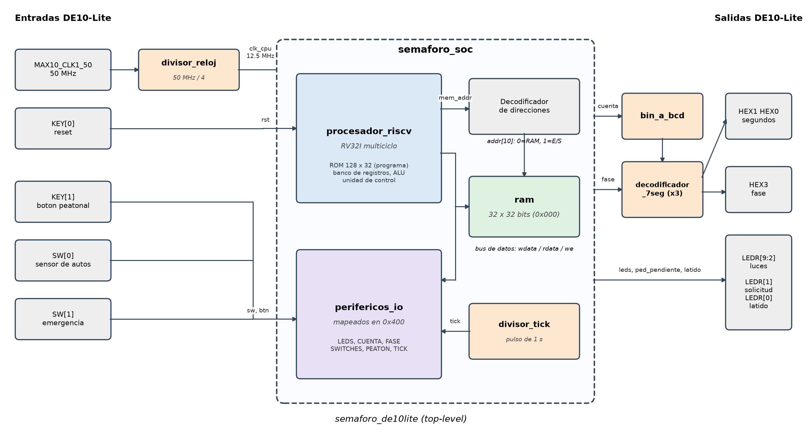
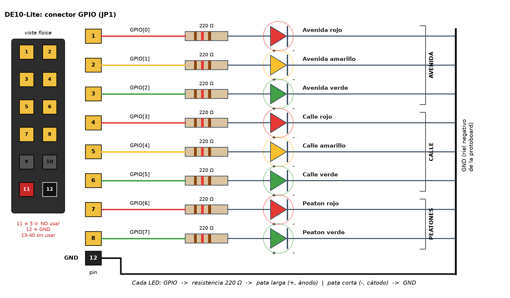
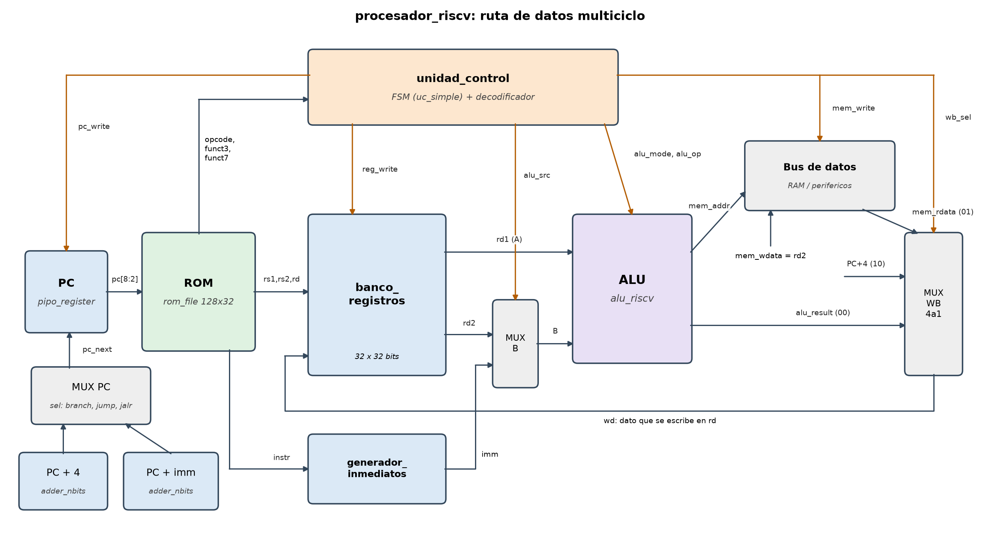
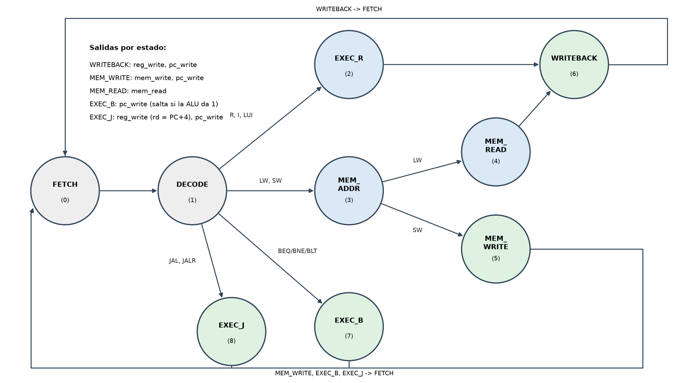
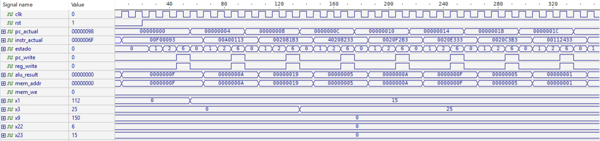

# Semáforo inteligente con procesador RISC-V en FPGA (DE10-Lite)

Proyecto final de **Arquitecturas Computacionales**. Universidad de las Américas Puebla,
Departamento de Computación, Electrónica y Mecatrónica.

Es un **procesador RISC-V de 32 bits multiciclo** escrito en Verilog. El procesador ejecuta, desde
su ROM, un programa en ensamblador que controla un **semáforo inteligente** en la tarjeta
**Terasic DE10-Lite** (Intel MAX 10). El procesador se armó con los módulos desarrollados en
clase (ALU, sumador, multiplexor, registro, ROM, RAM y unidad de control).



---

## Contenido

- [Funciones del semáforo](#funciones-del-semáforo)
- [Uso en la DE10-Lite](#uso-en-la-de10-lite)
- [Arquitectura del procesador](#arquitectura-del-procesador)
- [Mapa de memoria](#mapa-de-memoria)
- [Estructura del repositorio](#estructura-del-repositorio)
- [Simulación en Active-HDL](#simulación-en-active-hdl)
- [Implementación en Quartus](#implementación-en-quartus)
- [Resultados](#resultados)
- [Autores](#autores)

---

## Funciones del semáforo

El cruce tiene una **avenida principal**, una **calle secundaria** y un **paso peatonal**.

| Función | Comportamiento |
|---|---|
| Verde mínimo | La avenida está en verde al menos 10 s |
| Sensor de autos | Si no hay autos en la calle, la avenida sigue en verde. Si hay, la calle recibe 8 s de verde |
| Botón peatonal | Guarda la solicitud, recorta el verde de la avenida a 3 s y da 7 s a los peatones |
| Emergencia | Desde cualquier fase pone **todos los semáforos en rojo** mientras esté activa |
| Cuenta regresiva | Los displays muestran los segundos restantes y el número de fase |
| Estadísticas | El programa cuenta en RAM los peatones atendidos, las emergencias y los ciclos de la calle |


| Fase | Avenida | Calle | Peatones | Duración |
|:-:|:-:|:-:|:-:|:-:|
| 1 | 🟢 | 🔴 | 🔴 | ≥ 10 s (espera auto o peatón) |
| 2 | 🟡 | 🔴 | 🔴 | 3 s |
| 3 | 🔴 | 🟢 | 🔴 | 8 s |
| 4 | 🔴 | 🟡 | 🔴 | 3 s |
| 5 | 🔴 | 🔴 | 🟢 | 7 s |
| E | 🔴 | 🔴 | 🔴 | mientras `SW[1]` = 1 |

---

## Uso en la DE10-Lite

| Control | Función |
|---|---|
| `KEY[0]` | Reset |
| `KEY[1]` | Botón peatonal |
| `SW[0]` | Sensor de autos en la calle |
| `SW[1]` | Modo emergencia |

| Salida | Significado |
|---|---|
| `LEDR[9:7]` | Avenida: rojo, amarillo, verde |
| `LEDR[6:4]` | Calle: rojo, amarillo, verde |
| `LEDR[3:2]` | Peatones: rojo, verde |
| `LEDR[1]` | Solicitud peatonal pendiente |
| `LEDR[0]` | Latido de 1 s |
| `HEX1 HEX0` | Segundos restantes |
| `HEX3` | Fase (1 a 5, `E` en emergencia) |
| `GPIO[7:0]` | LEDs rojos, amarillos y verdes en protoboard (conector JP1, pines 1 a 8) |

### LEDs de colores en protoboard

Los LEDs de la DE10-Lite son todos rojos. Por eso las mismas luces también salen por el conector
GPIO (JP1) hacia LEDs de colores en una protoboard. Cada LED va de su pin GPIO a una resistencia
de **220 Ω** y luego a la pata larga (+); la pata corta (−) va a **GND (pin 12)**.
**No usar el pin 11, que es de 5 V.**

| Pin JP1 | Señal | Pin FPGA | LED |
|:-:|---|---|---|
| 1 | `GPIO[0]` | `PIN_V10` | 🔴 Avenida rojo |
| 2 | `GPIO[1]` | `PIN_W10` | 🟡 Avenida amarillo |
| 3 | `GPIO[2]` | `PIN_V9` | 🟢 Avenida verde |
| 4 | `GPIO[3]` | `PIN_W9` | 🔴 Calle rojo |
| 5 | `GPIO[4]` | `PIN_V8` | 🟡 Calle amarillo |
| 6 | `GPIO[5]` | `PIN_W8` | 🟢 Calle verde |
| 7 | `GPIO[6]` | `PIN_V7` | 🔴 Peatón rojo |
| 8 | `GPIO[7]` | `PIN_W7` | 🟢 Peatón verde |
| 12 | GND | — | Cátodo (−) de todos los LEDs |



#### Lista de materiales

| Material | Cantidad | Detalle |
|---|:-:|---|
| LED rojo 5 mm | 3 | Avenida, calle y peatón |
| LED amarillo 5 mm | 2 | Avenida y calle |
| LED verde 5 mm | 3 | Avenida, calle y peatón |
| Resistencia 220 Ω, ¼ W | 8 | Una por LED (colores: rojo-rojo-café) |
| Protoboard | 1 | Media o completa |
| Cables jumper **hembra-macho** | 9 | Del conector JP1 de la tarjeta a la protoboard (8 señales + GND) |
| Cables jumper macho-macho | ~5 | Para el riel de GND dentro de la protoboard |

Conviene comprar algunos de repuesto (por ejemplo, 2 LEDs extra de cada color y 2 resistencias),
porque un LED conectado al revés o una pata rota es común.

**Por qué 220 Ω:** los pines de la FPGA dan **3.3 V**. Con un LED rojo o amarillo (~2.0 V):
I = (3.3 − 2.0) / 220 ≈ **6 mA**, que es suficiente para verlo encendido y seguro para el pin de la FPGA.
Con 330 Ω también funciona, pero se ve más tenue. **No usar menos de 150 Ω.**
Compren LEDs **verdes normales (difusos)**: los verdes "ultrabrillantes" necesitan ~3 V y con
3.3 V casi no encienden.

#### Armado paso a paso

1. **Con la tarjeta desconectada del USB**, ubica el conector **JP1 (GPIO)** de 40 pines y busca
   el **pin 1** (está marcado en la serigrafía). Los pines van en dos filas:
   1-2 arriba, 3-4 abajo, y así sucesivamente; **11 = 5 V** y **12 = GND**.
2. En la protoboard, conecta un cable del **pin 12 (GND)** de la tarjeta al **riel negativo (−)**.
3. Para cada uno de los 8 LEDs (en el orden de la tabla):
   - Cable hembra-macho del **pin JP1** a una fila de la protoboard.
   - **Resistencia de 220 Ω** de esa fila a otra fila.
   - **Pata larga (+, ánodo)** del LED en la fila de la resistencia.
   - **Pata corta (−, cátodo)** del LED al **riel negativo (GND)**.
4. Acomoda los LEDs como semáforos: rojo arriba, amarillo en medio y verde abajo, en tres grupos
   (avenida, calle, peatón).
5. Revisa que **nada** esté conectado al **pin 11 (5 V)** y que ningún cable toque dos pines.
6. Conecta el USB, programa la tarjeta desde Quartus y presiona `KEY0` (reset).

**Prueba rápida:** al arrancar deben encender el 🟢 verde de la avenida, el 🔴 rojo de la calle y
el 🔴 rojo del peatón. Si un LED no enciende, gíralo: probablemente está al revés.

---

## Arquitectura del procesador

- ISA: subconjunto de **RV32I + `mul`** (25 instrucciones de los formatos R, I, S, B, U y J).
- Microarquitectura **multiciclo**, controlada por una máquina de estados basada en `uc_simple`.
- 32 registros de 32 bits, ROM de 128 instrucciones y RAM de 32 palabras.
- Reloj del procesador: 12.5 MHz (50 MHz / 4).

| Formato | Instrucciones |
|---|---|
| R | `add sub and or xor slt sll srl sra mul` |
| I | `addi andi ori xori slti slli srli srai lw jalr` |
| S | `sw` |
| B | `beq bne blt` |
| U | `lui` |
| J | `jal` |



| Instrucción | Estados de la unidad de control | Ciclos |
|---|---|:-:|
| R, I, `lui` | FETCH → DECODE → EXEC_R → WRITEBACK | 4 |
| `lw` | FETCH → DECODE → MEM_ADDR → MEM_READ → WRITEBACK | 5 |
| `sw` | FETCH → DECODE → MEM_ADDR → MEM_WRITE | 4 |
| `beq bne blt` | FETCH → DECODE → EXEC_B | 3 |
| `jal jalr` | FETCH → DECODE → EXEC_J | 3 |



### Módulos

| Módulo | Origen | Descripción |
|---|---|---|
| `alu_riscv` | clase | ALU de 32 bits (se usa sin cambios) |
| `adder_nbits` | clase | Sumadores PC+4 y PC+inmediato |
| `mux_4a1` | clase | Elige el dato que se escribe en el registro destino |
| `pipo_register` | clase | Contador de programa (PC) |
| `rom_file` | adaptado | Memoria de instrucciones (`$readmemh`) |
| `ram` | adaptado | Memoria de datos (se corrigió la polaridad de `we`) |
| `unidad_control` | adaptado | FSM de `uc_simple` con estados para saltos y decodificador de la ALU |
| `banco_registros` | nuevo | 32 × 32 bits, `x0` = 0 |
| `generador_inmediatos` | nuevo | Inmediatos de los formatos I, S, B, U y J |
| `procesador_riscv` | nuevo | Ruta de datos |
| `perifericos_io` | nuevo | Registros de E/S mapeados en memoria |
| `divisor_tick`, `divisor_reloj` | nuevo | Tick de 1 s y reloj del procesador |
| `bin_a_bcd`, `decodificador_7seg` | nuevo | Conversión para los displays |
| `semaforo_soc` | nuevo | Procesador + RAM + periféricos |
| `semaforo_de10lite` | nuevo | Top-level con los pines de la tarjeta |

---

## Mapa de memoria

| Dirección | Registro | Acceso | Uso |
|---|---|:-:|---|
| `0x000`–`0x07F` | RAM | L/E | Datos y estadísticas |
| `0x400` | LEDS | E | Luces (`LEDR[9:2]`) |
| `0x404` | CUENTA | E | Segundos para `HEX1 HEX0` |
| `0x408` | FASE | E | Fase para `HEX3` |
| `0x40C` | SWITCHES | L | `SW[9:0]` sincronizados |
| `0x410` | PEATON | L/E | Solicitud peatonal (escribir la borra) |
| `0x414` | TICK | L/E | Pasó 1 segundo (escribir lo borra) |

---

## Estructura del repositorio

```
├── Arquis_ProyectoFinal.aws              Workspace de Active-HDL
├── Arquis_ProyectoFinal/Arquis_ProyectoFinal/
│   ├── Arquis_ProyectoFinal.adf          Diseño de Active-HDL
│   ├── resultados_tb_*.txt               Salida de cada testbench
│   └── src/
│       ├── *.v                           Módulos del procesador y del sistema
│       ├── tb_*.v                        Testbenches
│       ├── programa_semaforo.asm/.hex/.lst      Programa del semáforo
│       └── prueba_instrucciones.asm/.hex/.lst   Programa de prueba del procesador
├── quartus/
│   ├── semaforo_de10lite.qpf / .qsf      Proyecto y asignación de pines
│   ├── semaforo_de10lite.sdc             Restricciones de tiempo
│   ├── pines_de10lite.csv / .tcl         Pines para importar en el Pin Planner
│   └── programa_semaforo.hex             Programa que carga la ROM al sintetizar
└── Reporte/                              Reporte en LaTeX (main.tex, figuras/, codigo/)
```

- `.asm`: el programa en ensamblador RISC-V.
- `.hex`: el código máquina que carga la ROM.
- `.lst`: la dirección y el código de cada instrucción.

---

## Simulación en Active-HDL

1. Abrir `Arquis_ProyectoFinal.aws` en Active-HDL.
2. **Design → Compile All**.
3. Seleccionar el testbench como *top-level* y elegir **Simulation → Initialize Simulation**.
4. Agregar las señales al *Waveform* y correr la simulación.

| Testbench | Qué prueba |
|---|---|
| `tb_banco_registros` | Escritura/lectura, `x0` = 0, reset |
| `tb_perifericos_io` | Registros de E/S, sincronizadores, botón y tick |
| `tb_procesador_riscv` | Ejecuta `prueba_instrucciones.hex` y revisa 25 registros y la RAM |
| `tb_semaforo_de10lite` | Sistema completo: arranque, autos, peatón, emergencia y displays |

En la simulación del sistema, `TICK_DIV = 200`, así que un "segundo" dura 16 µs para que la
prueba sea corta. En la tarjeta, `TICK_DIV = 12 500 000`.

---

## Implementación en Quartus

1. Abrir `quartus/semaforo_de10lite.qpf` en Quartus Prime Lite (dispositivo `10M50DAF484C7G`).
2. **Processing → Start Compilation**.
3. **Tools → Programmer**, seleccionar `output_files/semaforo_de10lite.sof` y presionar **Start**.

Los pines ya están en el `.qsf`, **incluidos los 8 GPIO de la protoboard** (`GPIO[0]`–`GPIO[7]`,
pines `PIN_V10`, `PIN_W10`, `PIN_V9`, `PIN_W9`, `PIN_V8`, `PIN_W8`, `PIN_V7`, `PIN_W7`).
Para revisarlos: **Assignments → Pin Planner**. En otro proyecto se pueden importar con
**Assignments → Import Assignments** usando `quartus/pines_de10lite.csv`.
El archivo `programa_semaforo.hex` debe estar en la carpeta del proyecto de Quartus.

> Copia la carpeta **completa** del repositorio (o descarga el ZIP de GitHub), no solo `quartus/`:
> el proyecto toma los `.v` de `Arquis_ProyectoFinal/Arquis_ProyectoFinal/src/`.

---

## Resultados

Los cuatro testbenches terminan con **"TODAS LAS PRUEBAS PASARON"**:

| Testbench | Verificaciones |
|---|:-:|
| Banco de registros | 9 / 9 |
| Periféricos | 8 / 8 |
| Procesador | 27 / 27 (184 ciclos, CPI ≈ 3.76) |
| Semáforo | 7 / 7 escenarios (incluye las salidas GPIO a la protoboard) |

Simulación completa del semáforo:


Botón peatonal (la cuenta se recorta a 3 s y luego viene la fase 5):


Emergencia (todos los semáforos en rojo):


Procesador ejecutando instrucciones tipo R (estados 0 → 1 → 2 → 6):



El análisis completo está en el reporte (`Reporte/main.tex`).

---

## Autores

| Nombre | Matrícula |
|---|---|
| Juan Diego Acosta Ojeda | 185015 |
| Mario Cardeña García | 180220 |

**Profesor:** Omar Guillén Fernández. Diciembre de 2026.
